<div align="center">

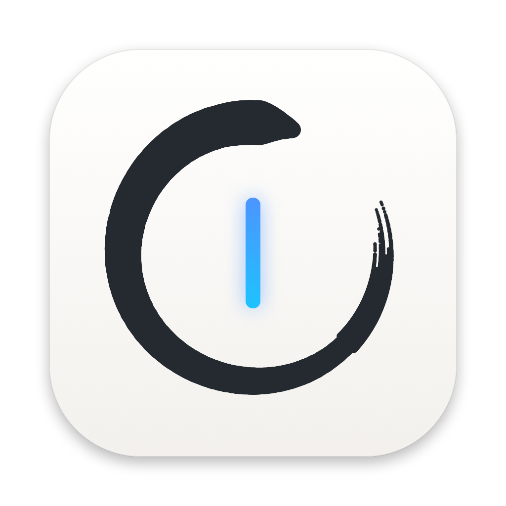

# ZenPad

**A quiet Markdown notepad that lives in your Mac's menu bar.**

Press a shortcut, write, close. Your notes are plain Markdown files you own.

[](https://github.com/pronzzz/zenpad/releases/latest)


[](LICENSE)

[**Download ZenPad 2.0**](https://github.com/pronzzz/zenpad/releases/latest) · [What's new](CHANGELOG.md) · [Shortcuts](#keyboard-shortcuts) · [Build from source](#building-from-source)

<br>

<picture>
  <source media="(prefers-color-scheme: dark)" srcset="docs/screenshots/editor-dark.png">
  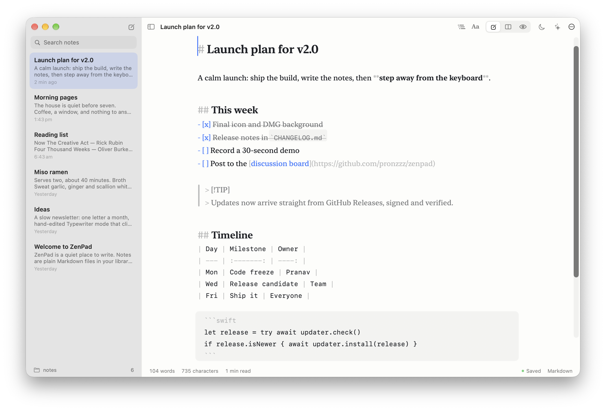
</picture>

</div>

## Why ZenPad

- **Always one keystroke away.** `⌃⌥N` drops a small Quick Pad under the menu bar icon from any app. No Dock icon, no window to manage.
- **Markdown that looks like writing.** Headings, emphasis, links, tasks, quotes and code are styled as you type, while the syntax stays visible and quiet.
- **Your files, your folder.** Every note is a `.md` file in a folder you choose. Open them in any other editor, back them up, or keep them in iCloud Drive.
- **Calm by design.** One window, a translucent sidebar, a header that fades away in Focus Mode, and gentle spring animations.
- **Private.** No accounts, no analytics. The optional writing assistant runs on your Mac with Ollama.
- **Updates itself.** New releases arrive from this repository, verified with a cryptographic signature before they're installed.

## A tour

### Quick Pad

Click the ensō in the menu bar, or press `⌃⌥N` anywhere. Jot something down, press `⌘↩` to save it as a note, or expand it into the full editor. The scratch text is kept between sessions, and your recent notes are one click away.

<p align="center">
  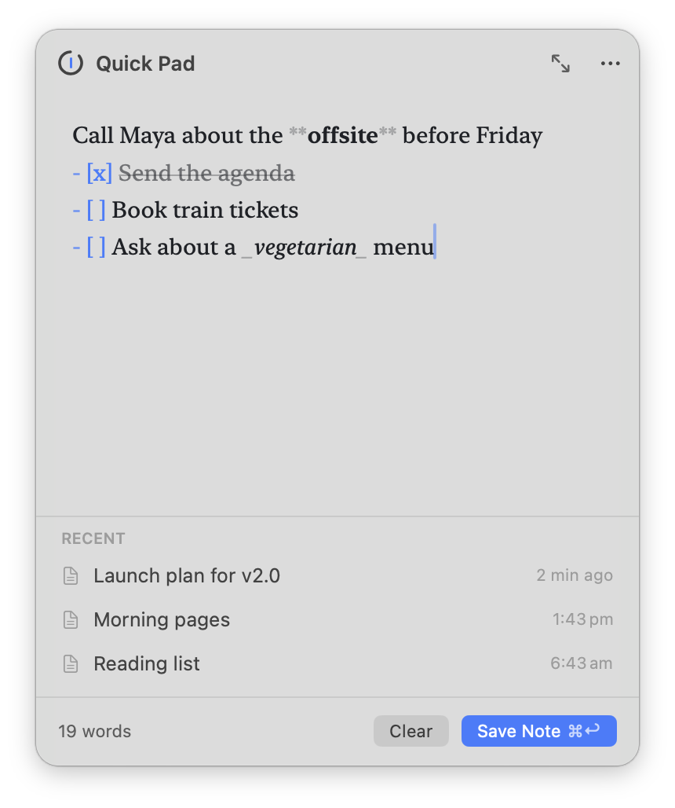
  &nbsp;
  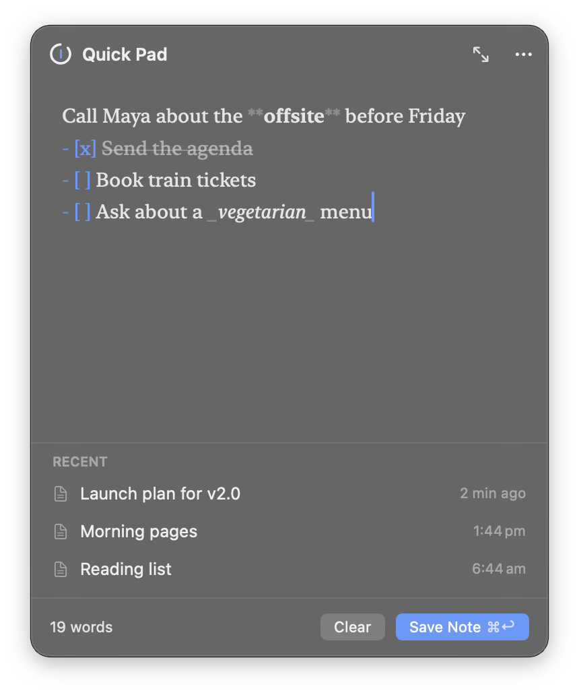
</p>

### Write, Split, Preview

Switch with `⌘1` `⌘2` `⌘3`. The preview renders GitHub Flavored Markdown (tables, task lists, footnotes, alerts and highlighted code), follows your scroll position, and updates in place without flickering. Tick a checkbox in the preview and the note updates.

<p align="center">
  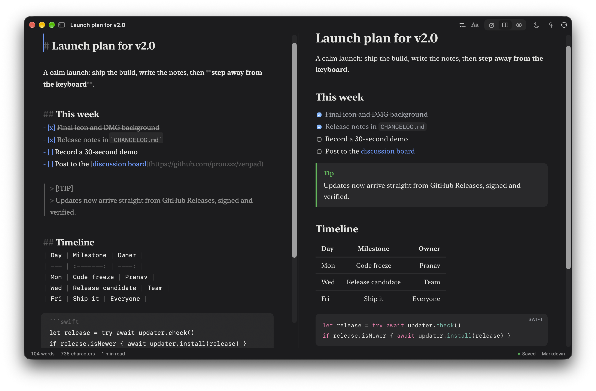
</p>

### Fonts that fit the moment

New York, SF Pro, SF Pro Rounded and SF Mono, plus classic writing fonts that ship with macOS (Charter, Iowan Old Style, Palatino, Avenir Next and more). Size, line height and line width are adjustable; the preview uses the same font.

<p align="center">
  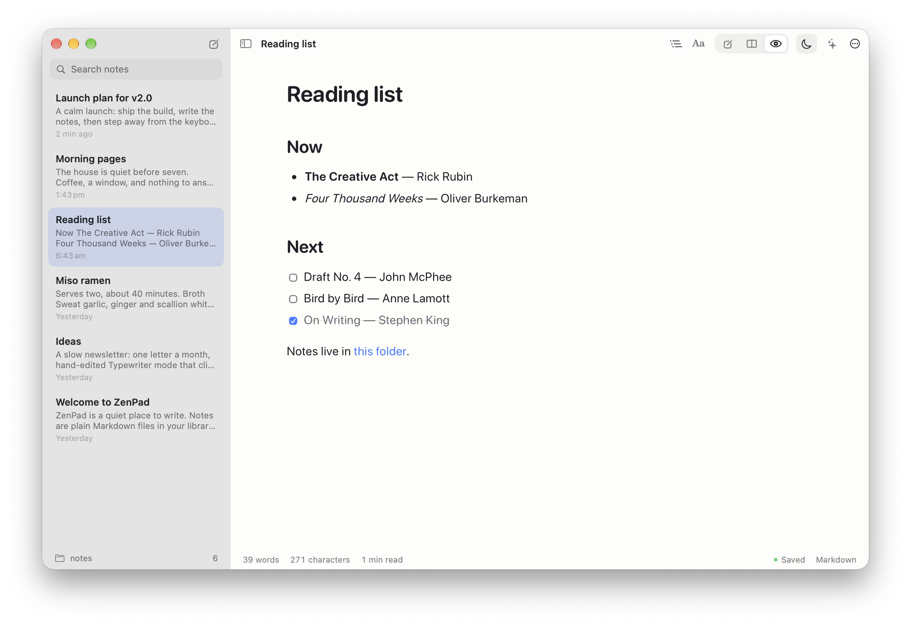
</p>

### Focus Mode

`⇧⌘F` hides the sidebar and toolbar and dims every paragraph except the one you're writing. Move the mouse to the top to bring the header back; press `Esc` to leave. Typewriter scrolling keeps your line centred if you like that.

<p align="center">
  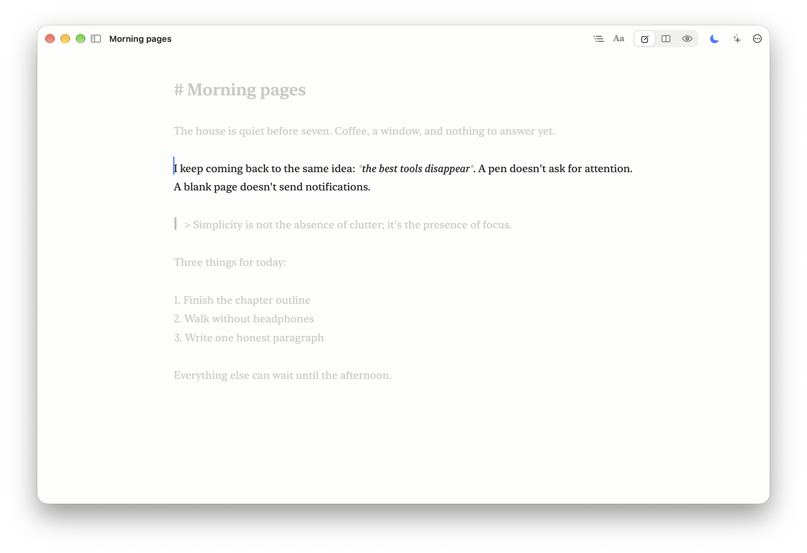
</p>

### Templates

Start from a Daily Journal, Meeting Notes, To-do List, Blog Post, Project Plan or README. Placeholders like `{{date}}` and `{{weekday}}` are filled in for you, and any `.md` file you drop into the templates folder becomes a template.

<p align="center">
  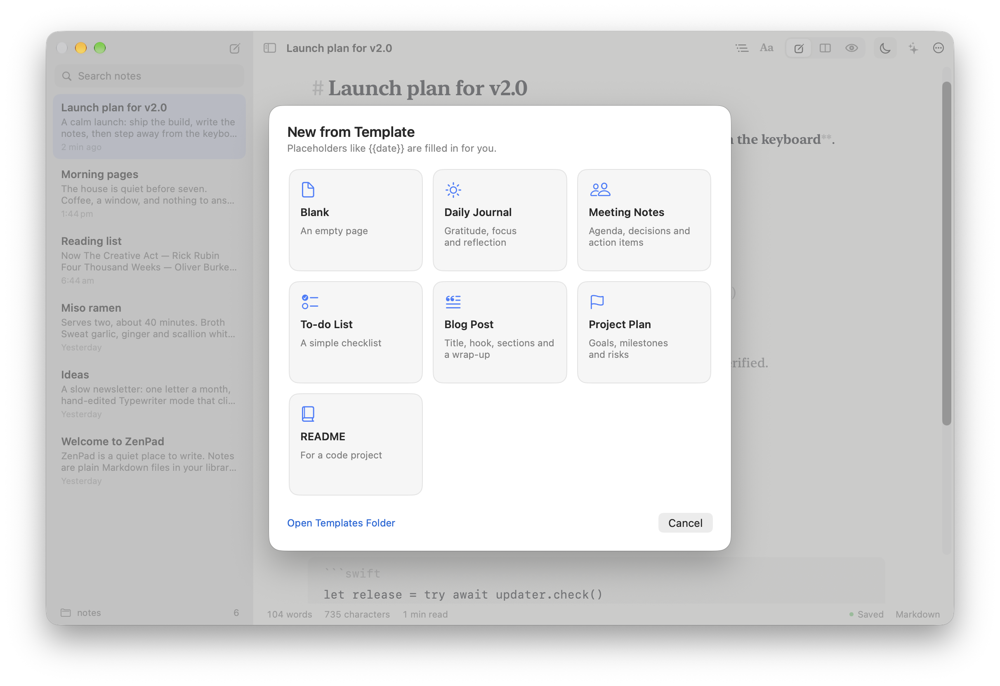
</p>

### Settings

<p align="center">
  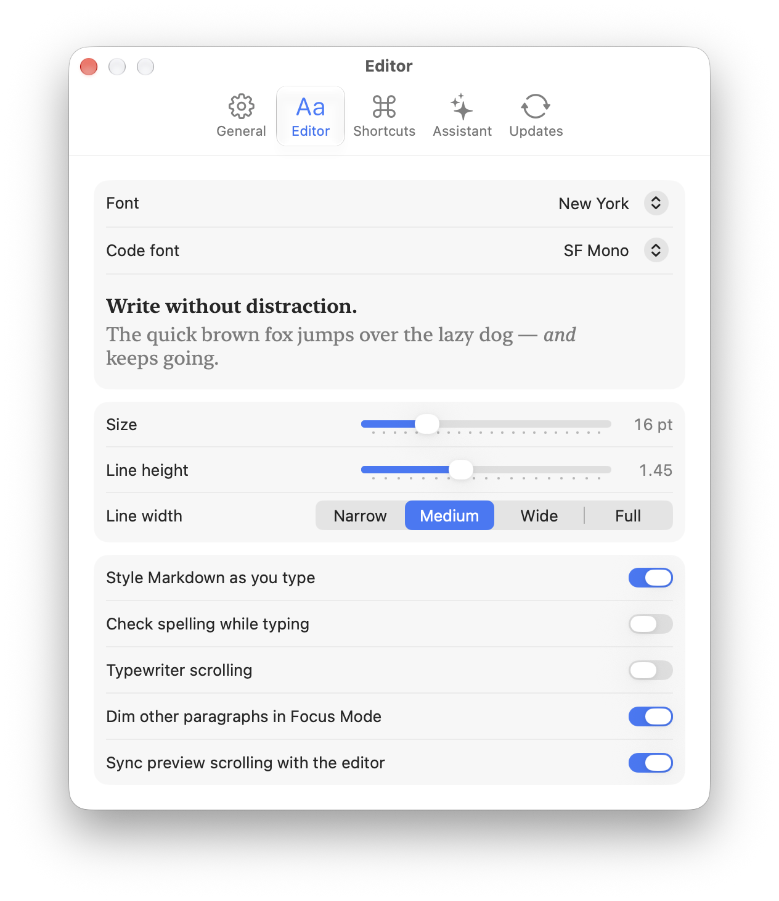
  &nbsp;
  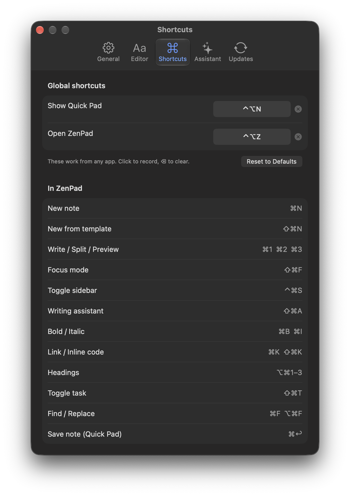
</p>

## Features

**Writing**
- Live Markdown styling with visible-but-quiet syntax
- Smart lists: Return continues bullets, numbers and tasks; Tab and Shift-Tab indent
- Click `[ ]` to tick a task; `⌘`-click to open a link
- Outline menu for jumping between headings
- Find and Replace, word count, reading time
- Writing Assistant with Ollama: improve, fix grammar, shorten, expand, summarize, continue, change tone, suggest titles, or ask anything

**Markdown**
- CommonMark plus GitHub extensions: tables with alignment, task lists, strikethrough, autolinks
- Footnotes and `> [!NOTE]` / `[!TIP]` / `[!WARNING]` alerts
- Syntax highlighting for Swift, Python, JavaScript/TypeScript, Go, Rust, C-family languages, Ruby, shell, SQL, JSON, YAML and CSS
- Raw HTML is sanitized in the preview (no scripts or event handlers)

**Notes**
- Plain `.md` files in any folder you choose (default `~/Documents/ZenPad`)
- File names follow each note's first line; saving is automatic
- Changes made by other apps show up immediately
- Open any `.md` or `.txt` file from Finder
- Export to PDF or HTML, copy as HTML, print, share

**App**
- Menu bar app; the Dock icon only appears while the editor is open
- Global shortcuts you can re-record
- Opens to the Quick Pad, the editor, or stays in the menu bar; optional launch at login
- Light, dark or automatic appearance
- Signed automatic updates from GitHub Releases
- Universal: Apple silicon and Intel

## Installation

1. Download **ZenPad-2.0.0.dmg** from the [latest release](https://github.com/pronzzz/zenpad/releases/latest).
2. Open it and drag ZenPad into Applications.

   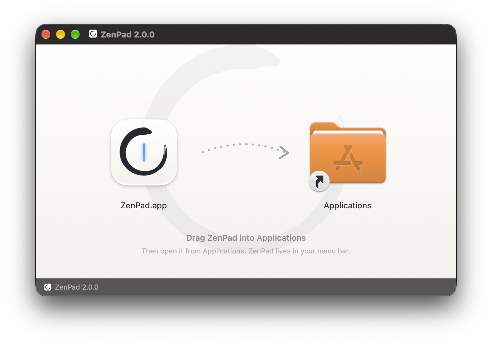

3. Open ZenPad from Applications. Because ZenPad isn't notarized by Apple, macOS will say it can't verify the developer the first time. Open **System Settings → Privacy & Security**, scroll down, and click **Open Anyway**. You only need to do this once; updates install from inside the app.

ZenPad needs macOS 14 Sonoma or later.

> [!TIP]
> Prefer the terminal? After dragging the app to Applications you can clear the quarantine flag yourself:
> `xattr -dr com.apple.quarantine /Applications/ZenPad.app`

### Updating

ZenPad checks for a new release once a day (turn this off in Settings → Updates, or check by hand from the menu bar icon). When one is available you'll see the release notes and an **Install and Relaunch** button.

<p align="center">
  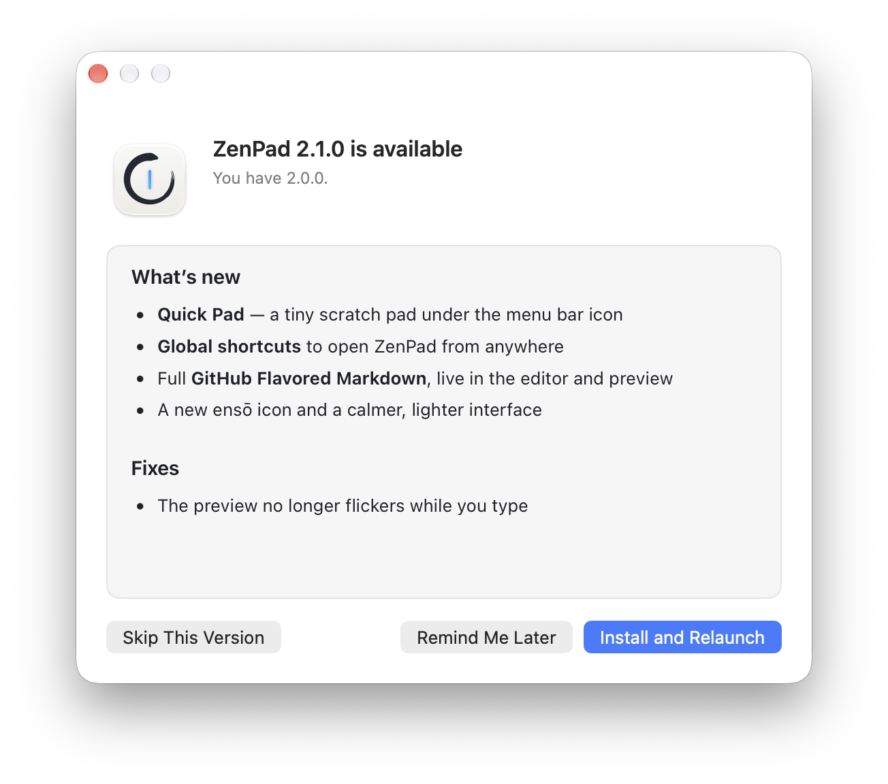
</p>

How it stays safe: each release ships `ZenPad-<version>.zip` alongside an Ed25519 signature (`.zip.sig`). The app verifies the signature against the public key built into it, checks the bundle identifier, version and code signature of the downloaded app, and only then swaps it in. If anything doesn't match, nothing is replaced.

## Keyboard shortcuts

| Anywhere on your Mac | |
| --- | --- |
| Show / hide the Quick Pad | `⌃⌥N` |
| Open the editor | `⌃⌥Z` |

| In ZenPad | |
| --- | --- |
| New note / from template | `⌘N` / `⇧⌘N` |
| Write / Split / Preview | `⌘1` `⌘2` `⌘3` |
| Focus Mode | `⇧⌘F` |
| Toggle sidebar | `⌃⌘S` |
| Search all notes | `⇧⌘L` |
| Writing Assistant | `⇧⌘A` |
| Bold / Italic | `⌘B` / `⌘I` |
| Link / Inline code | `⌘K` / `⇧⌘K` |
| Heading 1–3 | `⌥⌘1` – `⌥⌘3` |
| Toggle task | `⇧⌘T` |
| Code block | `⌥⌘C` |
| Find / Find and Replace | `⌘F` / `⌥⌘F` |
| Bigger / Smaller / Actual size | `⌘+` / `⌘-` / `⌘0` |
| Typewriter scrolling | `⌃⌘T` |
| Save Quick Pad as a note | `⌘↩` |

The two global shortcuts can be changed in Settings → Shortcuts.

## Writing Assistant (optional)

The assistant uses [Ollama](https://ollama.com), so everything runs on your Mac and nothing is sent anywhere.

```bash
brew install ollama
```

```bash
ollama pull llama3.2
```

Start Ollama, then press `⇧⌘A` in ZenPad. Pick a different model or server address in Settings → Assistant. The assistant works on your selection, or on the whole note when nothing is selected.

## Syncing between Macs

ZenPad doesn't run its own sync. Choose a folder inside iCloud Drive (or Dropbox, Syncthing, a Git repo…) in Settings → General → Notes folder, and point ZenPad at the same folder on your other Mac.

## Building from source

Requirements: Xcode 26 or later and [XcodeGen](https://github.com/yonaskolb/XcodeGen).

```bash
brew install xcodegen
```

```bash
git clone https://github.com/pronzzz/zenpad.git && cd zenpad && xcodegen generate && open ZenPad.xcodeproj
```

`project.yml` is the source of truth for the Xcode project; regenerate after adding files. Run the tests with `⌘U` or:

```bash
xcodebuild -project ZenPad.xcodeproj -scheme ZenPad test
```

### Project layout

```
ZenPad/
  App/          entry point, menu bar item, main menu, editor window, demo scenes
  Core/         preferences, fonts, theme, notes library, editing session, hotkeys
  Editor/       the TextKit writing surface and the WebKit preview
  Markdown/     swift-markdown → HTML renderer, live styler, editing commands, highlighter
  Services/     templates, Ollama assistant, export, GitHub updater
  Views/        SwiftUI: main window, sidebar, Quick Pad, settings, update window
ZenPadTests/    renderer, editing, library, updater and styler tests
scripts/        release, screenshots, artwork and update-key tools
```

### Releasing

```bash
scripts/release.sh --publish
```

This builds a universal Release, runs the tests, creates `dist/ZenPad-<version>.dmg`, the update zip and its signature, and publishes the GitHub release with the matching section of [CHANGELOG.md](CHANGELOG.md) as notes. Pushing a `v*` tag runs the same script in GitHub Actions ([release.yml](.github/workflows/release.yml)), which needs the `ZENPAD_UPDATE_PRIVATE_KEY` repository secret.

The update signing key is created once with `swift scripts/update_keys.swift generate` and stored outside the repository in `~/.config/zenpad/update_signing_key`. Its public half is in `ZenPad/Resources/Info.plist` (`ZPUpdatePublicKey`).

Other scripts:

- `scripts/screenshots.sh` renders every screenshot in this README using the app's demo mode (sample notes in a temporary folder; your own notes and settings are never touched).
- `swift scripts/make_art.swift` draws the app icon and DMG background.

## Troubleshooting

**"ZenPad can't be opened because Apple cannot check it for malicious software."** See step 3 of [Installation](#installation).

**The global shortcut does nothing.** Another app may already use that combination. Record a different one in Settings → Shortcuts.

**I can't see the menu bar icon.** On crowded menu bars macOS hides icons behind the notch. Use `⌃⌥N` / `⌃⌥Z`, or hold `⌘` and drag other icons to make room.

**The assistant says it's offline.** Make sure Ollama is running (`ollama serve`) and the model in Settings → Assistant has been pulled.

**Where are my notes?** In the folder shown at the bottom of the sidebar. Right-click a note and choose **Show in Finder**.

## Privacy

ZenPad makes exactly two kinds of network request: a daily check of this repository's GitHub releases (which you can turn off), and, if you use the assistant, requests to your own Ollama server (localhost by default). There is no telemetry.

## License

[MIT](LICENSE) © Pranav Dwivedi
